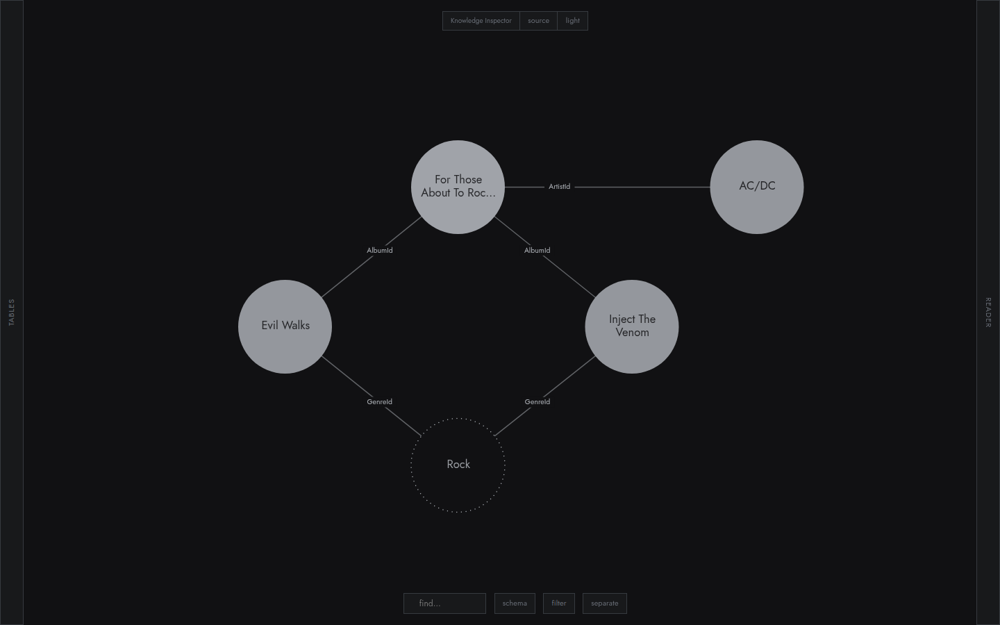
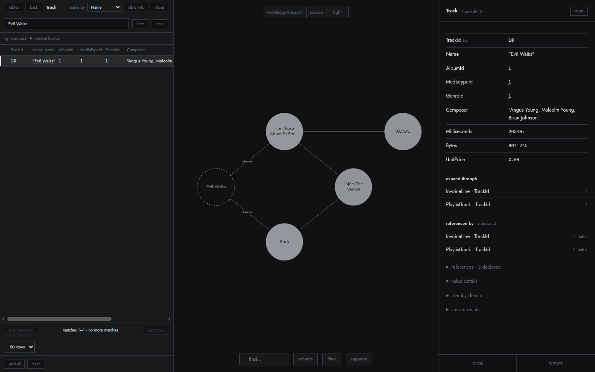
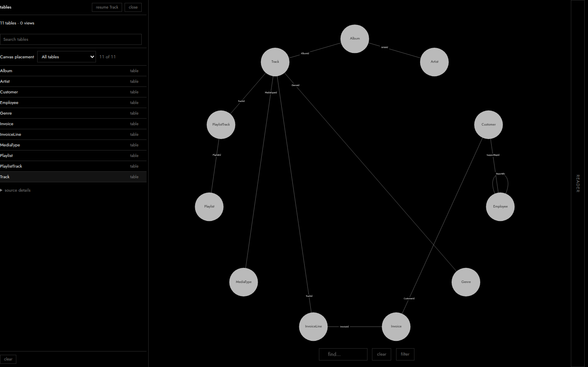
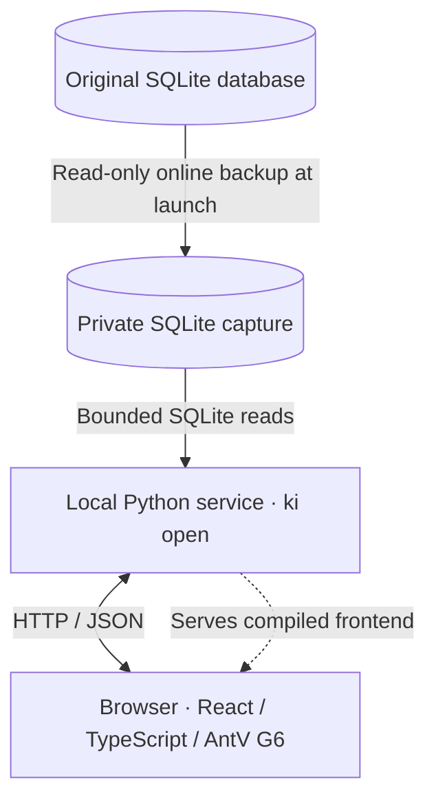

# Knowledge Inspector

**Explore structured data through its relationships.**

Knowledge Inspector is a local, read-only SQLite application for exploring individual records and their connections.

Start with a track and follow its album and artist, or open an invoice and explore its customer and line items. The organizing idea is relationship-first exploration: follow connected records while keeping the context you have already opened.

The canvas serves as a spatial working set. Records opened individually remain available as you browse elsewhere; you can arrange them, revisit them and display references you follow or expand. Tables provide access to records, the Reader shows their values, and the schema view provides structural context.

The motivation is to support people in developing their own understanding through direct exploration. Knowledge Inspector complements SQL and other inspection tools. It does not automate interpretation, and the record canvas is not an exhaustive database diagram.

> **Work in progress.** This is an early, functional application under active development. Relationship discovery, expansion limits, large-table coverage and platform compatibility are still being refined. See [Current limitations](#current-limitations).



*Two tracks share Album 1, “For Those About To Rock We Salute You”, and Genre 1, Rock. The album connects to Artist 1, AC/DC. The album title is shortened inside its disc; selection and hover reveal connection names.*

## How it works

With [Chinook open](#installation-and-quickstart), the initial view shows its schema and table catalogue. In each table’s header, choose `name by`: use `Name` for Track, Artist and Genre, and `Title` for Album. These choices affect labels; verified keys remain the identities.

Then build a small investigation:

1. Open Track, filter `Evil Walks`, submit the filter and select **TrackId 10**. Its values open in the Reader, and the record appears on the canvas.
2. Follow the Reader’s `AlbumId=1` value to **Album 1**, “For Those About To Rock We Salute You”.
3. Follow the album’s `ArtistId=1` value to **Artist 1**, AC/DC.
4. Return to Track, filter `Inject The Venom`, and select **TrackId 8**. Follow its `AlbumId=1` value to the existing album.
5. Revisit each track and follow its `GenreId=1` value to **Genre 1**, Rock.

The result is five records and five displayed connections: two tracks sharing an album and genre, with the album connected to its artist. Close both panels and arrange the marks to create the canvas view above.

Opened records remain available while you explore elsewhere. Hiding an individual connection keeps its endpoint records; removing canvas material changes the working set, not the database. Other declared relationships between visible records may remain undrawn unless followed or expanded.

Incoming references can also be browsed as a filtered table or expanded onto the canvas. To inspect the original track again, open Track, filter `Evil Walks` and select TrackId 10:



### Schema context

The `schema` control returns to the database’s declared structure. These marks represent tables, rather than individual records. Chinook declares 11 tables and 11 foreign keys; the catalogue and relationship names are visible below.

<a href="docs/images/readme/schema.png"></a>

[Open the full-resolution schema image](docs/images/readme/schema.png) to inspect its small relationship captions. All three images come directly from the installed application; [capture details and reproduction](docs/README_SCREENSHOTS.md) are recorded separately.

## Installation and quickstart

You need Python 3.11 or newer, its SQLite library at version 3.37 or newer, Node.js 22.12 or newer, npm and a web browser. Build from the source checkout:

```bash
python3 -m venv .venv
. .venv/bin/activate
python3 scripts/build_release.py
python3 scripts/test_installed_wheel.py -v
python -m pip install --no-deps release/knowledge_inspector-0.1.0-py3-none-any.whl
ki open database.sqlite
```

The build downloads the locked frontend dependencies, compiles the application and creates a local wheel. The installed application needs Python and SQLite, but not Node.js. A plain `pip install .` does not build the frontend.

No GitHub Release or PyPI distribution is currently available. Prebuilt wheel distribution is on hold while third-party notices are resolved; see the [notice inventory](THIRD_PARTY/README.md).

The command takes a private SQLite capture, prints a local address and opens the browser. The original database is opened read-only; browsing then uses the fixed capture. Keep the terminal process running: Ctrl+C stops the service and releases its capture. Use `ki open database.sqlite --no-browser` to print the address without opening a browser.

To try the pinned Chinook sample database:

```bash
python3 examples/chinook/prepare.py
ki open examples/chinook/data/Chinook_Sqlite.sqlite
```

The preparer downloads and verifies the sample. Dataset provenance and licensing are recorded in the [Chinook documentation](examples/chinook/README.md). Detailed packaging, checkout and development instructions are in [Build and develop Source](docs/BUILD_AND_DEVELOPMENT.md).

## Technical architecture and engineering

Knowledge Inspector runs as a **self-contained local application**. The `ki open` command launches a loopback Python HTTP service, which serves both the compiled browser interface and the Source read API. Node.js and Vite are build-time tools, not runtime requirements; the installed wheel declares no third-party Python dependencies.



### Interactive frontend

**React and TypeScript** coordinate table browsing, record inspection, relationship navigation and the canvas. The application owns typed state for independently placed records, followed references, positions and expansion groups. Source record identities are separate from visual element IDs and display labels.

**AntV G6** provides the graphical renderer, picking, drag, zoom and camera primitives. Application code integrates these with record placement and selection, custom record/relationship presentation, Reader synchronization and keyboard navigation; `d3-force` supports placement and settling. This is not a custom rendering or physics engine. [Canvas implementation](src/source/SourceCanvas.tsx) · [Field model](src/source/sourceField.ts)

**Interaction coordination** includes cancellation-aware reads, rejection of stale responses, and a pointer-aware draw queue for pending canvas updates. Refresh can restore a session's working set only after rereading its records and references. [Read ownership](src/source/useSourceRead.ts) · [Session and recovery evidence](docs/ENGINEERING_EVIDENCE.md)

### Database correctness and reliability

- **Consistent captures.** SQLite's online backup API makes a private capture; requests remain bound to their original session and capture context, so different generations cannot silently mix. The original database is not modified. [Capture evidence](docs/ENGINEERING_EVIDENCE.md)
- **Exact record identities.** Declared primary keys are checked before placement, and foreign-key observations distinguish resolved, unsupported and incomplete relationships. Human-readable labels never become identities. [Identity design](docs/ENGINEERING_EVIDENCE.md)
- **Bounded reads.** Pagination, SQLite execution limits and aggregate incoming-reference count budgets bound individual operations; an incomplete result is not silently presented as zero. [Bounded-read evidence](docs/ENGINEERING_EVIDENCE.md)

### Testing and measured results

**Playwright** covers real SQLite-backed record and reference navigation, canvas interaction and keyboard focus, plus deterministic mocked HTTP errors, cancellation and recovery. A recorded Source browser run reports **283 passing scenarios**; most of those browser tests run against the development frontend, so they are not production performance benchmarks. [Recorded test run](docs/evidence/source-browser.txt) · [Canvas tests](tests/source-canvas-motion.spec.ts) · [Error tests](tests/source-errors-mocked.spec.ts)

Separate end-to-end browser tests launch the **installed Python wheel without Vite**. The packaging checks also validate compiled assets, installation outside the checkout, capture cleanup and source-file integrity. [Installed application tests](tests/app-launcher.app.ts) · [Packaging evidence](docs/ENGINEERING_EVIDENCE.md)

A measured identity-handling refactor reduced **retained Python allocations after verification from 52.4 MB to 0.8 MB** in a documented 91,966-row Stack Exchange workload, measured with `tracemalloc` rather than process RSS. It preserved whole-table verification while retaining handles only for records returned to the user. [Methodology and measurements](docs/ENGINEERING_EVIDENCE.md)

## Current limitations

- **SQLite and declared relationships only.** Navigation uses declared foreign keys; relationships are not inferred from names, matching values or application conventions.
- **Placement requires verified identity.** Keyless rows, view output and rows with unsupported or invalid keys remain table-only, where readable.
- **Whole-table verification is bounded.** Identity verification has a default ceiling of **200,000 rows per table**, alongside time and SQLite instruction budgets. Smaller tables can also exceed those budgets.
- **Issued handles have separate session limits.** The session permits at most **200,000 issued record handles** and **64 MiB of accounted registry payload**, including records returned by reads but never placed on the canvas. This accounting bound is not a process-memory cap. Reads that would exceed either limit issue no new handles; previously issued handles remain valid.
- **Connections are selective.** A missing line does not establish that two visible records are unrelated.
- **Expansion and dense canvases.** `add all` places the current table page; `expand through` can traverse an entire relationship group. Dense arrangements can become difficult to interpret and less responsive, and remain an area for refinement.
- **Exploration is session-scoped.** The same tab can restore its canvas on refresh during a launch. A new launch starts empty; there are no saved projects.
- **Compatibility is still being evaluated.** Testing has focused on Linux; macOS and Windows are untested. SQLite behavior follows the library supplied with Python. Tests cover SQLite 3.51.1 and 3.53.1; tight query budgets can refuse expensive incoming-reference reads. See the [validation notes](docs/SQLITE_COMPATIBILITY.md).

## Development and direction

Near-term refinements concern relationship discoverability, greater control over expansion, support for larger keyed tables and the usability of dense arrangements.

Physical tables and foreign keys are not always the concepts a person wants to explore. A longer-term direction is to **consume optional, externally defined, data-backed conceptual models**: object types, properties, identities and named links mapped to underlying data through SQL queries and joins. The same spatial exploration interface could then help people inspect higher-level objects and their links, while keeping modeled interpretations distinguishable from recorded database structure.

Knowledge Inspector would not necessarily author or own these models; it could read them from another system. A separate possible capability is a **SQL-queryable semantic model** in which queries address those logical objects and links directly. Using SQL to define mappings does not itself provide such a query interface. Neither capability is part of the current application.

The underlying focus remains direct exploration of connected information.

## Further technical documentation

- [Build and develop Source](docs/BUILD_AND_DEVELOPMENT.md), including packaging, session details and development servers.
- [API contract](API_CONTRACT.md), including the Source read interface.
- [Engineering evidence](docs/ENGINEERING_EVIDENCE.md), including validation and recorded measurements.

Technical reports record their implementation revisions, measurement conditions and remaining limitations.

## License

MIT License. See [LICENSE](LICENSE), the [third-party notice inventory](THIRD_PARTY/README.md), and [project attribution](AUTHORS.md).
