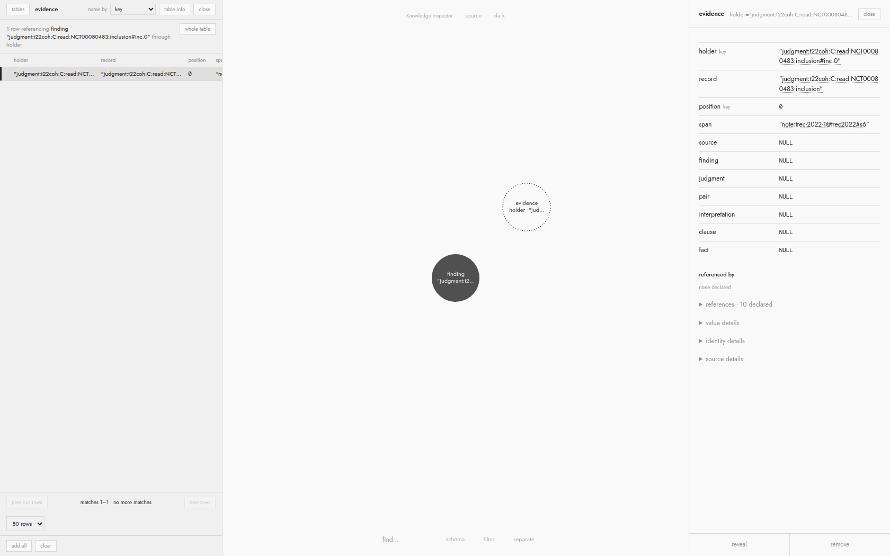

# Following records in Knowledge Inspector

An evidence row identifies the finding that holds a citation and the record it cites. Reaching one cited span from its finding took three clicks. I had to know that the column to choose was `evidence.holder`. The adjacent `evidence.finding` was also populated, but led to *other findings citing this one*. In Chinook, getting from “Evil Walks” to its album took one click on the recorded album number. The difference matters more than the number of controls: in the first case the person has to reconstruct the direction of a two-leg path.

## 1. Routes in the current interface

I ran the checkout launcher (`bin/ki open … --no-browser`) for the supplied CTM store and Chinook, using the existing compiled frontend, checkout `f6f9cd2`, real SQLite reads, Playwright with Chrome, a 1680 × 1050 viewport and default direct placement. The walks and pictured comparisons below are observations. The inventory also covers routes traced in code. World comparisons and failure cases without pictures are based on the implementation and contract. Recommendations and their expected effects are judgments.

**How to read the table.** Reader is the right panel containing one subject. Tables is the left panel containing a window of rows. Canvas holds the records and connections accumulated in this tab. “Record read” below means `GET /source/v1/record?id=<verified handle>`. On a record landing the workspace also requests `references?record=…&direction=outgoing` and, where available, `direction=incoming`, independently, ten declarations at a time. All short endpoint names below are GETs under `/source/v1/` in the established session and generation. An observation identifies one particular child record and one FK declaration. Two FKs between the same tables can therefore describe different observations.

| Control and starting point | Landing and reads | What changes, and the return |
|---|---|---|
| Tables catalogue, schema table mark, table result in global Find | Tables rows via `rows?table=…`, Reader table metadata. Catalogue uses `overview` and `schema`. | Opens a table and starts a window. Tables Back restores a prior table when present. Catalogue/resume toggles the directory. A schema line selects a declaration in the schema, never a particular row. Schema/clear changes canvas rooms. |
| Table Find, precise lookup, sort, page, page size | Tables via `search?mode=literal/primary_key` or `rows` with window/order. Same paging controls work on incoming search. | Changes candidate rows, clears row selection/Reader trail. Clear filter, unsort or page back. An exact composite key needs each typed component in declared order. |
| Click a row or its “Inspect row N” button | Reader record read. A window-only row opens its returned cells locally. | Sets selection, clears Reader trail. Default also places/reveals the verified record. Select another row, close Reader, or revisit a mark. |
| Global Find hit | `find?text=…` (and continuation), then verified hit → Reader record read. A handleless hit → Tables literal filter for that text. | Starts new subject, direct placement for a verified hit. Repeat Find or revisit canvas. A window-only result cannot identify the same row again. |
| Load address with `record_table` and `record_key` | After restore, `search?mode=primary_key&limit=2`, then Reader record read only for a unique, exact typed match with handle. | Direct placement. Entry once per load, no in-app history push or automatic URL update as one follows. Restart from link, canvas or Find. Bad link yields a local alert. |
| Dotted recorded cell | Reader → parent Reader. Uses resolved observation from current outgoing page. In direct mode reads parent for placement and again as Reader subject. | Pushes Reader Back, places endpoints and draws this FK. In `?placement=explicit` only navigates. All parts of a uniquely reachable composite FK can lead to the same parent. Shared columns can lose their dot. |
| “references · N declared”, previous/next references | Reader disclosure lists recorded values, parent/key and resolution. Opening uses already requested observations. Paging → outgoing `references`. | Keeps record. Open state persists across subjects. Close disclosure or page back. Count includes NULL and failed observations. |
| “inspect reference” within a declaration | Reader becomes the observation, exact `reference?record=<child>&fk=<decl>`; uses child record. | Pushes Reader Back. Direct mode also reads/places a verified parent and draws the connection. A NULL or failed observation can still be inspected. |
| “from” child, arrow target, “open referenced record” on observation | Reader → exact child or parent by handle. The arrow and footer call the same parent handler. | Pushes Reader Back to observation. No new placement by these handlers; inspection may already have placed both ends. Endpoint links offered together only for an addressable observation. |
| “show connection” / “reveal connection”, “hide connection”, cancel pending placement | Observation stays in Reader. Show/reveal reads exact parent, uses grounded child and observation, reveals line on canvas. Hide/cancel local. | Adds/reuses endpoints and connection. Hide leaves endpoints. Show again to reverse. Cancel abandons in-flight placement. |
| “referenced by”, previous/next declarations | Reader lists child table **and FK columns**, exact count or qualification. Paging → incoming `references`. Click group → Tables `search?mode=reference&table=child&record=parent&fk=decl`. | Reader stays parent, Tables becomes scoped, canvas unchanged. Re-click current group focuses dock. Choose a child or another group. Zero is a note, unavailable count can be browsed, invalid declaration cannot. |
| Row in reference-mode Tables | Child Reader, normal record read and two reference lists. | Clears Reader trail, direct-places child **without drawing the incoming observation**. Dock remains scoped to original parent. Tables Back restores saved table and Reader if a prior table existed. |
| “whole table” / “back to previous table” | Whole → ordinary child `rows`. Back → saved `rows` or `search` and restored Reader reads as needed. | Whole drops narrowing and re-enables Find. Back pops a table snapshot including Find, sort, window, incoming filter, verified selection and Reader trail. No snapshot for initial catalogue-only state. Whole table is not an undo of the journey. |
| “expand through” / “take off” | Reader stays parent. Canvas gets parent plus placeable children **and** connections. Parent record read + `records?mode=reference` windows of 100 for whole group. | Tracks contributions by parent and declaration. Take off retracts the group locally, preserving independently placed/adopted or otherwise supported material. Run again to restore. Stop/failed pages can leave partial results. |
| Tables “add all”, “stop”, “clear” (take off table) | Canvas. `records` for the **visible page** with current filter/order. Reference-mode page also includes its observations and uses the expansion group. | Adds records (and scoped edges). Stop keeps completed pages. The table footer’s “clear” removes records of that table across the canvas, wider than the page added. Right-click marked row/table removes one/all of that table. |
| Reader “show on canvas” / “reveal” / “remove” | Canvas, same Reader. Uses verified record in hand. | Places/adopts record or pans to existing one. Remove also takes incident edges. Re-show record and individual edges to reconstruct. |
| Canvas disc, line, line label, keyboard field list | Disc → record Reader. Line/individual label → child record + exact observation Reader. Shared stroke can represent multiple FKs; grouped label opens individual names. List selection also reveals the mark. | Selects existing material, clears Reader trail. Pick previous mark or list entry to return. Blank canvas clears selection. Right press, Delete/Backspace or list × removes record or hides edge. No new discovery from proximity or crossing lines. |
| Canvas show filters, separate/undo separate, drag, pan/zoom, catalogue “clear” | Canvas only, no reads for display changes. | Visibility, geometry and camera are distinct from selection. Reset filter or move back; undo separate while available. Clear removes the working set. No general undo. |
| Reader Back / close | Back restores last Reader subject and outgoing page, rereading as needed. Close dismisses panel. | Record-to-observation and dotted routes push this stack. Row selection, Find and canvas selection start a new one. Closing can expose Tables on a compact screen. Neither Back removes placements. |

**World comparison.** World’s units are a referent and a relation occurrence with named roles. A track role on a `track_on_album` occurrence reaches its referent. The corresponding reads are `/world/assertion?id=…` for the occurrence and `/world/referent?id=…` for the participant. Relation tables read `/world/rows?relation=…&subject=…` for occurrences mentioning a referent, with “whole relation” to widen. “Expand through” uses `/world/expand`, with take-off on the field. “On this disc” offers already drawn links; occurrence previews can open a particular assertion. Source has a similarly named component deliberately omitted from its Reader. Both have Find, table rows, marks, selection and panel controls. World roles can connect several participants through one occurrence; Source’s pairwise, directed FK and its resolution status are a different piece of evidence. The Source typed-key address is specific to Source. [World contract](../API_CONTRACT.md#endpoints) · [Chinook declaration](../examples/chinook/declaration.json) · [World Reader](../src/world/WorldPage.tsx)

## 2. Three walks

Each linked image is the full viewport **after** that numbered action. Step 0 opens the named key via the address in a fresh browser context. Counts start with the record already open, exclude loading, pointer travel and scrolling, and count every subsequent button/row click including Back. These are repeatable paths, not claimed minimums. The same dock can stay visible while attention changes sides.

### A. Z3 judgment → evaluated clause, both facts and their note sentences · 18 clicks

The judgment is `judgment:t22fz1:z3:NCT00204269:pre.1`, outcome `met`. Its `requirement` points to a requirement. The actual clause text and fact records are reachable through its finding’s three evidence rows.

| Click / screenshot | Control | Landing and evidence |
|---|---|---|
| [0](traversal-review/a-00.png) | Open exact key in judgment | Reader and canvas. The rationale names Z3, the clause expression and the result. |
| [1](traversal-review/a-01.png) | Referenced by finding · judgment | Reader → Tables. One finding. Judgment stays on the right. |
| [2](traversal-review/a-02.png) | Inspect row 1 | Tables → Reader. Finding with ref ending in #pre.1. It joins the canvas. |
| [3](traversal-review/a-03.png) | Referenced by evidence · holder | Reader → Tables. Three evidence rows for this holder. Reader stays on finding. |
| [4](traversal-review/a-04.png) | Inspect row 1 | Tables → Reader and canvas. Composite key (finding ref, INTEGER 0). The populated target column is clause. |
| [5](traversal-review/a-05.png) | Follow clause → clause | Reader → Reader and canvas. Clause pre.1, expression below. Tables still lists the three rows. |
| [6](traversal-review/a-06.png) | Inspect row 2 | Tables → Reader and canvas. Same holder, position 1, populated fact. |
| [7](traversal-review/a-07.png) | Follow fact → fact | Reader → Reader and canvas. local_hypogonadotropic_hypogonadism, value stored as TEXT true. |
| [8](traversal-review/a-08.png) | Referenced by fact_reads · holder | Reader → Tables. One fact_reads row. Reader still shows the fact. |
| [9](traversal-review/a-09.png) | Inspect row 1 | Tables → Reader and canvas. fact_reads position 0 holds a span FK. |
| [10](traversal-review/a-10.png) | Follow span → span | Reader → Reader and canvas. s6, field text, offsets 525–620. |
| [11](traversal-review/a-11.png) | Follow field → source_field | Reader → Reader and canvas. Composite source_field key (source, name). Whole note text, including sentence 6. |
| [12](traversal-review/a-12.png) | Back to previous table | Tables Back restores the three evidence rows **and the first fact in Reader**. Canvas keeps the note. |
| [13](traversal-review/a-13.png) | Inspect row 3 | Tables → Reader and canvas. Same evidence holder, position 2. |
| [14](traversal-review/a-14.png) | Follow fact → fact | Reader → Reader and canvas. local_sex. Its TEXT value includes the quote characters around male. |
| [15](traversal-review/a-15.png) | Referenced by fact_reads · holder | Reader → Tables. One fact_reads row for this second fact. |
| [16](traversal-review/a-16.png) | Inspect row 1 | Tables → Reader and canvas. Another holder, again position 0. |
| [17](traversal-review/a-17.png) | Follow span → span | Reader → Reader and canvas. s0, field text, offsets 0–62. |
| [18](traversal-review/a-18.png) | Follow field → source_field | Reader → Reader and canvas. Same source_field record reused, this time via s0. |

The stored clause is `sex == "male" and hypogonadotropic_hypogonadism`. The two spans describe slices of the same text. Applying their recorded zero-based, end-exclusive offsets gives “6. The hormonal evaluation showed serum testosterone level of 65 ng/dL with low levels of GnRH.” and “0. A 19-year-old male came to clinic with some sexual concern.” The Reader opens the whole text field without highlighting either slice. The fact rationale gives the interpretation; the span gives its source. Reading the note does not independently validate the judgment.

### B. Finding → span cited as evidence · 3 clicks

The finding is `judgment:t22coh:C:read:NCT00080483:inclusion#inc.0`. Its rationale mentions low GnRH and testosterone. Two incoming lines both begin with “evidence”.

| Click / screenshot | Control | Landing and evidence |
|---|---|---|
| [0](traversal-review/b-00.png) | Open exact key in finding | Reader and canvas. evidence · finding has two rows (citations of this finding). evidence · holder has one (its own citation). |
| [1](traversal-review/b-01.png) | Referenced by evidence · holder | Reader → Tables. One evidence row, scoped by holder. The finding stays on the right. |
| [2](traversal-review/b-02.png) | Inspect row 1 | Tables → Reader and canvas. Position 0 has a span, seven NULL alternative targets, plus holder and record. |
| [3](traversal-review/b-03.png) | Follow span → span | Reader → Reader and canvas. The cited span is note:trec-2022-1@trec2022#s6. |

A second finding took the same three clicks but ended at another finding. From [the settling finding](traversal-review/cites-00.png), I opened [evidence through holder](traversal-review/cites-01.png), selected [position 0](traversal-review/cites-02.png), then followed [the populated finding column](traversal-review/cites-03.png) to `judgment:t22live:read:trec-2022-1:NCT00001412:inclusion#inc.0`. The outer shape of both journeys is identical. The differing filled column determines the target.

### C. Judgment → every referring row and any reassessed target · 7 clicks

The starting key is `judgment:t22live:base:trec-2022-1:NCT00001412:inc.0`. Four incoming declarations fit on one page. Three have one row each, one has an exact zero. Opening the three tables suffices to enumerate every direct referring row for this judgment.

| Click / screenshot | Control | Landing and evidence |
|---|---|---|
| [0](traversal-review/c-00.png) | Open exact key in judgment | Reader and canvas. Both outgoing reassessment cells visibly NULL. Incoming self-FK count zero. |
| [1](traversal-review/c-01.png) | Referenced by evidence · judgment | Reader → Tables. Evidence holder ending in NCT00001412:inclusion#INC, position 0. |
| [2](traversal-review/c-02.png) | Referenced by finding · judgment | Reader → Tables. Finding with the parent id plus #inc.0. No trip back to reselect the parent. |
| [3](traversal-review/c-03.png) | Referenced by shown · judgment | Reader → Tables. shown row with this judgment and position 0, convention_set convset:trialgpt-inclusion@v1. |
| [4](traversal-review/c-04.png) | Open references to inspect both reassessment declarations | Reader disclosure. Tables still shows the scoped shown row. |
| [5](traversal-review/c-05.png) | Inspect reassesses_judgment | Reader observation. FK 1, judgment → judgment, “NULL reference · no target required”. |
| [6](traversal-review/c-06.png) | Back to judgment | Reader returns to judgment; disclosure remains open. |
| [7](traversal-review/c-07.png) | Inspect reassesses_finding | Reader observation. FK 0, judgment → finding, also NULL. No target to open. |

Three clicks listed all children. The last four audited the two NULL observations explicitly. A read-only aggregate across all 10,106 judgment rows found **0** non-NULL reassesses_judgment and **0** non-NULL reassesses_finding. A successful reassessment follow cannot be demonstrated on this file. An evidence citation of a judgment is a different declaration. As a positive self-FK control, I selected ReportsTo on [Chinook Employee 2](traversal-review/self-00.png). One click reached [Employee 1, Andrew Adams](traversal-review/self-01.png). His own ReportsTo is NULL, and two employees reference him through that same declaration. The two ends are distinguishable by their keys even when both table names read Employee.

**Starting the walks again.** Use the address printed by the new local launcher. For A append the query parameters `record_table=judgment` and URL-encoded `record_key=[{"column":"id","storage_class":"text","exact":"judgment:t22fz1:z3:NCT00204269:pre.1"}]`. Use the same shape with table/column `finding/ref` for B and `judgment/id` for C. The launch-specific port and session handles are unnecessary in the report.

**Chinook control.** From [Track 10, Evil Walks](traversal-review/chin-00.png), [click 1](traversal-review/chin-01.png) opened Album 1, “For Those About To Rock We Salute You”; [click 2](traversal-review/chin-02.png) opened Artist 1, AC/DC. Reader → Reader both times with the path drawn as it grew. No link row, role interpretation or table switch was needed.

*Walk B, click 2. The evidence row’s holder and span both lead somewhere. The person must choose the span to continue toward the cited material.*

## 3. What the controls let a person do

| Act | Current controls | Test of necessity |
|---|---|---|
| Read a subject | Inspect row, Find hit, address, mark, inspect reference, reference details, table info | A subject can be a record, an observation, a declaration or a window-only row. Inspecting a dangling FK must be possible even when following it is impossible. |
| Find connected subjects | Dotted value, observation endpoints, referenced by, scoped rows, direction and declaration pagers | Following and gathering can use one operation with a direction and a declaration. A result may have zero, one, many or an unknown number of matches. Choosing a result is the ordinary read act. An already-resolved unique endpoint admits a shortcut. |
| Change the working set | Show/remove record, show/hide edge, expand/retract group, add page, take off table, clear | Reading every matching row and keeping a subset are independent requests. One retained record, one retained observation and a group contribution need distinct identities even if they share one control pattern. |
| Return to context | Reader Back, table Back, previous page, whole table, resume table | Returning to an earlier scope with its selection cannot be reconstructed from the current FK alone. Close, widen scope and go back have different results. |

For traversal, the first three acts plus reversible navigation suffice. Finding an initial record is ordinary search; arranging, hiding labels, and revealing an existing mark are presentation operations. Neither should imply another database relationship. The draft misses reading the *relationship itself* and recovering the path. “Gather” is ambiguous if it means both listing rows and pinning all of them. Conversely, a separate verb for “open referenced record” adds nothing once the target is a readable subject.

**Observations that test the mapping**

- [Inspecting a resolved FK](traversal-review/extra-06.png) exposes two routes to precisely the same parent. Both call `openParent`. A dotted value skips the intermediate observation. [Hide](traversal-review/extra-07.png), [show](traversal-review/extra-08.png) and [open](traversal-review/extra-09.png) demonstrate three different outcomes with the same two endpoints.
- For every browsable incoming declaration, the Reader generally names it twice, once for listing rows and once for placement. From [the original finding](traversal-review/extra-00.png), [expand one row](traversal-review/extra-01.png) and [take it off](traversal-review/extra-02.png) changed the canvas while keeping the parent. Opening [the same group in Tables](traversal-review/extra-03.png) and [selecting its row](traversal-review/extra-04.png) drew no line back to that parent. Thus the canvas cannot by itself retrace walk A.
- A bridge such as `fact_reads` needs two FK legs and three clicks even for one match: choose incoming group, select bridge row, follow span. Evidence adds a choice among eight target columns. All **48,466** evidence rows in the supplied file have exactly one non-NULL target among the eight. The table DDL includes that CHECK. The other two FKs identify holder and source document. [All ten declarations](traversal-review/extra-05.png) are individually auditable. Treating this as one polymorphic FK would discard recorded structure.
- Composite keys distinguish occurrences. Positions 0, 1 and 2 in A share a holder; position alone recurs for other holders. The span’s `source` is shared by the FK to source and the composite FK to source_field. Its value is plain, while `field` alone is dotted and reaches the record identified by **both** components. The observation list is the way to disambiguate. Dot availability uses only the current outgoing page. On a schema with more than ten declarations a column may gain/lose a dot when the list pages; ambiguity on another page is invisible to this calculation (code inference).
- `records.seq=5` is the original note document. Of its 24 incoming declarations (one from each other base table), [the first ten](traversal-review/many-00.png) and [next ten](traversal-review/many-01.png) all have zero rows. Only [the last page](traversal-review/many-02.png) offers source (1), source_field (1) and span (7). Immediate neighbors and complete declaration inventory answer different questions. `record → records.id` is valuable for provenance, distracting when seeking the next citation. The target handle uses the verified key `seq`, even though the FK compares `id`.
- [The note source](traversal-review/large-00.png) has 10,106 judgments through subject. [Opening the group](traversal-review/large-01.png) and [paging](traversal-review/large-02.png) produced bounded row windows, without expanding the group. [Whole table](traversal-review/large-03.png) dropped the parent constraint. On this CTM source I paged and widened the result. Rendering 10,106 connections was not measured.
- From [the initial judgment workspace](traversal-review/view-00.png) I opened the `link` view. It has columns called holder, target and target_kind. [Its table information](traversal-review/view-01.png) identifies computed output. [Selecting a row](traversal-review/view-02.png) reads the values with a window position, no verified handle, dotted target or placement. A text value that happens to look like a key is insufficient authority to follow it.

## 4. Issues in order of interference

| Rank | Observed obstacle or code finding | Where to inspect |
|---|---|---|
| 1 | A reverse step interrupts the investigation. A singleton takes two clicks and two panels. Selecting the row clears Reader Back and loses the edge used to find it. After entering via a record link, the first group has no prior table snapshot at all. On narrow layouts only the owning dock can be foreground. | [Workspace](../src/source/SourceWorkspace.tsx), `openIncoming`, `select`, `rememberTable`, `backTable`; [dock layout](../src/source/sourceLayout.ts) |
| 2 | Direction and role choice precede reading. The same finding has both “evidence · holder” and “evidence · finding”, each repeated in a second list. Incorrect choice is plausible and still returns valid rows. Seven inspectable NULL targets and one provenance target obscure the domain target. | [References](../src/source/SourceReferences.tsx), `IncomingReferences`, `ExpandThrough`, `OutgoingReferences`; [record values](../src/source/SourceDetails.tsx) |
| 3 | The declaration pager can make a record with nine referring rows look isolated for two pages. The pager controls both listing and expansion. Outgoing dots likewise depend on the current ten declarations. | [Workspace](../src/source/SourceWorkspace.tsx), `incomingWindow`, `referencePage`, `reach`; [References](../src/source/SourceReferences.tsx) |
| 4 | A count-only button above the table route places a whole group. For the note source the number is 10,106. Add all in Tables places one page; table take-off has a broader scope. On [Chinook Artist 1](traversal-review/partial-00.png) I opened [its two albums](traversal-review/partial-01.png), chose [one row per page](traversal-review/partial-02.png) and clicked [add all](traversal-review/partial-03.png). The Reader then said “take off” and “placed 1” beside a group whose table count was still 2. The whole-group button now retracts that one instead of offering the second album. | [Workspace](../src/source/SourceWorkspace.tsx), `expandGroup`, `addAll`, `runBulk`; [field ownership](../src/source/sourceField.ts) |
| 5 | Default inspection and placement are coupled. Auditing a resolved FK changes the canvas. Revealing an existing connection fetches its parent again. The more detailed path offers the parent twice. | [Workspace](../src/source/SourceWorkspace.tsx), `directReference`, `placeReference`, `openParent`; [actions](../src/source/SourceReferences.tsx) |
| 6 | A span stops at offsets. Opening its composite FK shows the entire source field. The reader has to match the offsets to prose by hand. This is a limit of physical traversal for this task. | [RecordDetails](../src/source/SourceDetails.tsx), [scalar presentation](../src/source/sourceValueText.ts) |

### Other issues encountered

- **Contract drift.** “Source UI incoming exploration” ends with “Group expansion is not implemented.” The deployed checkout did expand and retract. The section also puts incoming below outgoing; the live order is values, expand through, referenced by, then the outgoing disclosure. The outgoing section’s statement about opening the matched parent fits the observation footer, but does not describe direct-mode cell navigation. [Contract](../API_CONTRACT.md#source-ui-outgoing-exploration) · [render order](../src/source/SourceWorkspace.tsx)
- **Recovery.** When three browser contexts opened addresses on the same research service simultaneously, one record link failed with `source_server_busy`. The workspace showed the code in the canvas and did not retry the lookup. Opening the same exact address in isolation succeeded. This was an admission failure under concurrent starts; the record existed. [Link handler](../src/source/SourceWorkspace.tsx) · [normal read recovery](../src/source/sourceExplain.ts)
- **Layout and accessibility.** In the evidence dock the long holder and record IDs consume the visible width before the varying target columns. On the keyboard the available row control is named “Inspect row 1” rather than identifying the composite-key occurrence. The canvas list provides actual buttons, but is visible only on keyboard focus. This is a control-name and discoverability inspection, not a screen-reader usability test. [Row controls](../src/source/SourceRowsView.tsx) · [field list](../src/source/SourceFieldControls.tsx)
- **Read cost.** The browser received two successful `record` responses on each dotted follow in A (one to place, one to read), followed by outgoing and incoming pages even with the outgoing list closed. No latency benchmark was run. Reusing a completed, context-checked read is worth distinguishing from relaxing verification. [Read owners](../src/source/SourceWorkspace.tsx)

## 5. Candidate designs

**A. Keep the journey in the Reader.** Put one relationship list below the recorded values. Each entry specifies direction, child columns and target table. A unique verified endpoint opens in the Reader in either direction; a larger group opens a paged list *inside the same Reader*, then a row opens there. An observation detail affordance remains available even for a NULL or failed FK. One Back restores the list and scroll position. Give each subject a separate canvas toggle, with explicit scopes for a page or group. In B this removes the dock change and can save the singleton selection. The cost is a second home for tabular results and less horizontal room. Existing `references`, reference `search`, `reference` and `record` suffice; for singleton reverse navigation fetch and verify the actual row. Amend UI landing/placement clauses. Counts alone never issue identities.

**B. Put every relationship result in Tables.** Use a single “rows” action beside each declared relationship, outgoing and incoming. Scope the dock to the chosen declaration and direction; a verified match opens in the Reader on selection. Inspect the observation through the same result, and place material only through a canvas action. Table Back restores both panels and the originating scope, including a parent entered via an address. Multi-row comparison, sorting and a full set of bridge columns remain available. Every singleton now costs two activations, including Track → Album. For outgoing rows the client can display the verified parent record returned by handle as a one-row window; preserve unmatched observations as qualified results, never invent a row. No new read endpoint required. Amend the UI contract to describe both directions, empty results, a restorable initial context and explicit placement.

Both designs preserve typed values, the declaration ID, ordered column pairs, observation identity and comparison basis. Keep declaration paging exhaustive behind details. If the product promises a complete list of nonempty incoming groups immediately, neither design gets it free: the client must page within budgets and show incomplete coverage, or a new bounded discovery response needs explicit continuation and count-status semantics. Neither design alone supplies the meaning of “cites”.

## 6. Where a declaration earns its place

- Calling the path judgment → finding → evidence → clause “evaluated”, and the paths to facts “used”, requires an attributed reading. A shared value in the rationale or a column called requirement does not establish those paths.
- Treating holder and one of eight columns as the participants of a named citation, distinguishing “cites” from “cited by”, or composing fact_reads and span into a quoted sentence needs the producer’s role names and offset convention. Source can reduce clicks on each leg while retaining the occurrence and position.
- Assigning `record` the role “originating JSON document”, or always demoting it relative to the other FKs, requires a declaration or user choice. Source can show that the FK resolves to records.id.
- Treating a `link` view row as a persistent relationship, or pairing two nullable reassessment columns into a named union, needs explicit identity and role evidence. Chinook’s declaration illustrates the boundary: it names `track_on_album` and leaves composer as text. [Chinook example](../examples/chinook/declaration.json)

## 7. Questions for the owner

1. On a reverse singleton, should selecting the declaration open the child immediately? Where should the person inspect the connecting observation before placing it?
2. Is the canvas meant to remember every followed leg or only what the person elects to keep? Which behavior should apply to a child reached from a filtered table?
3. Should one Back restore the previous investigation step across docks, including a starting record opened by address?
4. Should a person see resolved connections first, with the complete declaration ledger one disclosure away? What wording should accompany an incomplete page when counts are unavailable?
5. Is a page or a declaration group the natural unit for reversible bulk placement? How should a partially placed group indicate its coverage?

## 8. Source UI explanatory copy

This is an inventory of rendered copy paths, including disclosures, tooltips and conditional failures. The research and Chinook walks exercised the ordinary paths. The exception variants below come from the components; their presence here does not mean they occurred in the walks. Names, reasons, counts and grammatical variants are represented once per template. **A** is a standing truth, **B** an absence or ordinary state, **C** an exception a reader could otherwise misread. The last column is a proposed treatment under the owner's rule. Silence applies to commentary; exact NULL cells, counts, units, typed keys, source text, action names, accessible names and live progress still carry information.

### Reader, schema and canvas

| Current words | Where / class | Class → proposed treatment |
|---|---|---|
| “Fixed capture. A new capture requires an operator restart and explicit workspace reopening.” “capture observation, not producer commit time” | Source details throughout Reader and catalogue, `source-note` and time basis | A → Once in workspace capture information, label the timestamp “Captured at”. Keep digest, generation and session available. |
| “Historical enforcement is not established.” | Declaration details in table and observation Reader, `source-note` | A → State once in the schema legend under “Declared foreign keys”. |
| “Declared types are schema metadata; values can have other SQLite storage classes.” | Schema details, `source-note` | A → Once in value/type help. Use distinct “Declared type” and “Stored as” labels. |
| “Source grounding supports addressability, not independent factual verification or semantic endorsement.” | Record identity details, `source-note` | A → One definition of “Verified identity” in workspace help. Keep per-record grounding fields. |
| “Resolution describes this capture under the checked SQLite parent-affinity and collation rules, not independent factual verification.” | Observation details, `source-note` | A → One definition of “Resolved” in FK help. Retain the comparison basis in the observation. |
| “Connections on the canvas are references you followed or expanded. Other recorded references between these records may not be drawn.” | Drawn observation and canvas filter, `source-note` / `world-show__note` | A → Once at the canvas connection filter. No per-edge paragraph. |
| “hide connection on canvas · the recorded reference is unchanged” | Hide action tooltip, including field list × | A → “Hide connection” on the action. Explain display-only operations once with canvas controls. |
| “Computed output; lineage not recorded.” | View schema and window-only identity details | A for the view policy → once at view metadata. C when navigation is unavailable → “Computed row · no verified identity” by the row. |
| “No registered source handle. This selection is local to this window; its position is not a persistent record identity.” “canvas placement unavailable · [reason] · this page only” | Window-only row identity disclosure and placement area | C → one local “Page-local row · [reason]” label. Preserve window position as a position. |
| “none declared”, “references · none declared” | Outgoing, incoming and table schema, `source-note`, incoming also `world-reader__absent` | B → Omit empty relationship sections. An explicit schema inventory may retain numeric 0. |
| “No rows in this capture reference this record through [groups].” | Incoming list, `world__note world-reader__absent` | B → Remove prose. Keep the exact zero beside each FK in the declaration ledger; preserve the page range so an empty page never implies the whole search is empty. |
| “resolved”, “NULL reference · no target required” | Outgoing list and observation, `source-note` | B → Leave the verified target or the exact NULL cell. Preserve raw resolution code in details. A NULL alternative needs no paragraph or primary action. |
| “matching row has no verified record identity”, “no matching record in this capture”, “multiple matching records · no single target” | Observation status beside target | C → “Match lacks verified identity”, “Dangling in capture”, “Multiple matches” respectively. Preserve exact child values and recorded target. |
| “invalid reference declaration”, “reference could not be checked”, “reference check incomplete · query limit reached” | Same status area | C → “Invalid FK”, “Unchecked · [reason]”, “Incomplete · query limit”. |
| “no count · invalid declaration”, “count not checked · page limit reached”, “count unavailable” (query limit / page limit / BLOB values too large to check / unspecified) | Incoming line, expand line and reference-mode scope | C → One count-status label on affected FK, e.g. “Count not started · page limit” versus “Count incomplete · query limit”. Keep browse available if verified. |
| “[reason] No count, and its rows are not followed.” “[status] declaration”; “[reason] It stays listed as recorded; it is not followed.” | Incoming `source-limitation world-reader__absent`, table declaration, outgoing observation `source-limitation` | C → On the declaration “Cannot follow · [specific reason]”. Put original status/reason codes in its details. All reason variants below. |
| “[table] rows cannot be placed · [reason] · they can be read under ‘referenced by’”; “[reason] · rows stay on this page”; “rows of [table] cannot be placed · [reason]” | Expand list, table info and add-all footer, `source-limitation`; accompanying `source-note` | C → “Placement unavailable · [reason]” beside affected action. Keep ordinary browse action. Use one instance per affected surface. |
| “read unavailable · [reason]”, “column metadata unavailable”, “reference metadata unavailable”, “metadata unavailable”, “definition unavailable” | Unsupported table/view, key/type/columns/FK/SQL detail | C → Local “Read unavailable”, “Columns unavailable”, “FK metadata unavailable”, “Key/type unavailable”, “SQL unavailable”, with reason where supplied. |
| “unresolved [parent] table”, “unresolved column”, “row without a verified key”, “unavailable”, “value unavailable”, “no matched value” | FK endpoint, pair value, handle and resolved-pairs fields | C when missing/unchecked → mark the specific field. B for absent matched value on a known NULL → retain NULL child and omit empty target detail. |
| “not established” (verified rows), “not computed” (row count), “not declared” (type/default), “not recorded” (NOT NULL), “none” (idle expiry), “(implicit key)” / “(target omitted)” | Identity, schema, declaration, capture metadata | B for ordinary metadata absence → structured fields in details, no narrative. C for unknown verification → “Verified count unavailable”. Keep implicit-key basis beside the resolved pairs. |
| “nonfinite REAL”, “display text; identity is binary64 bits …”, “BLOB · N bytes · preview only”, “not a complete recoverable value”, “digest not computed” | Cells and value details | A → Once for REAL formatting. C → Label actual nonfinite value, BLOB preview, missing digest or reason locally. Keep exact bits, byte count and digest where supplied. |
| “This file declares no primary keys and no foreign keys. Its tables can be read, but records cannot be placed on the canvas or followed through declared references.” / “This file declares no primary keys. Its tables and declared references can be read, but no record can be placed on the canvas or followed.” / “This file declares no foreign keys. Records can be placed on the canvas, but there are no declared references to follow.” Each ends “This describes the recorded constraints only, not whether the data relates.” | Schema canvas and catalogue, including `source-limitation` | C → One file-level label “No declared keys / FKs” with the applicable parts only. A → State the scope of the schema once. |
| “from [child]”, “→ [parent]”, “N rows referencing [parent] through [columns]” | Observation and incoming table header | B → Keep as subject/scope labels. These identify what is open. Qualify missing counts as C. |
| “[table] records are named by [column] on the canvas: your choice, in this tab” / “… named by their key” | Table naming tooltip | A → Once at “name by”; current column/key is the control value. |
| “Right-click takes this row off the canvas”, “Place every row on this page on the canvas”, “No verified records to place on the canvas”, “Take every row of this table off the canvas” | Placed row and table bulk action titles | A → Teach right-click once. Use scoped action labels “Place page” and “Remove table from canvas”. C → Give specific identity limitation at disabled action. |
| “Back to the records on the canvas”, “Every table and its declared foreign keys”, “Push apart only what is sitting on top of something else”, “Put back what separate displaced”; show/hide records, connections, names on focus/at rest | Schema switch, separate/undo and canvas filter titles | A → Keep as action names/one-time control help. No per-subject qualifications. |

### Tables, Find, paging and session state

| Current words | Where | Class → proposed treatment |
|---|---|---|
| “Literal TEXT substring, matching case exactly as recorded” / “… ignoring case (full Unicode case folding; accents written differently do not match). INTEGER matches exact decimal integers; finite REAL uses numeric equality. NULL and BLOB contents are excluded. Whitespace is literal. Clearing resumes browsing.” | Precise literal lookup help | A → Once in Find help. Keep active case and column as filter labels. |
| “All primary-key components are required in their actual INTEGER or TEXT storage class. TEXT is case-sensitive and exact. REAL, NULL and BLOB key lookups are unsupported.” | Exact-key lookup help | A → Once at typed-key entry. C → Indicate specific missing/unsupported component where applicable. |
| “Tables by name, records by any value; ignores case”, “press enter to filter” | Global Find tooltip, draft table Find | A → Once in Find controls. Name submit action “Filter”. The global tooltip could specify searchable values. |
| “No tables match.”, “no tables or views”, “no tables or records match”, “no matches in the tables searched” | Catalogue and Find | B → Numeric result count. C if coverage partial → name skipped tables next to count. |
| “not searched: [tables and reasons]” with “too large to search here; use its table’s filter”, “its search ran out of its query limit; use its table’s filter”, “a virtual table, which is not read”, “could not be searched”, or raw reason; “the search stopped early · continue” | Global Find results | C → “Skipped · [table / reason]”, “Incomplete” + Continue. Keep route into table filter. |
| “could not continue: [failure]” / failure alone | Find list, field title, screen-reader alert | C → “Search failed” or “Continuation failed” near field, retain previous hits, retry where supported. Specific failures below. |
| “filter incomplete · no absence claim”, “filter incomplete”, “further rows exceed the offset limit”, “page unavailable” | Table read status and pager, latter also reference pagers | C → “Incomplete · [reason]”, “Offset limit”, “Page unavailable”. Never substitute 0. |
| “[identity limitation / unordered rows] · positions apply to this page only”, “ties in [column] keep no fixed order · positions apply to this page only” | Row window status | C → “Page-local order” or “Ties unordered” attached to window/order. Keep row identity separate. |
| “N rows with a BLOB over 1 MiB could not be checked · not listed” | Incoming search results | C → “N unchecked · BLOB size limit” in that result header. |
| “no further matches”, “no referencing rows in this capture”, “no matches · matches/ignores case; NULL and BLOB excluded”, “no rows on this page” | Empty row window | B → Page count and filter scope. A → Matching policy once in Find help. Distinguish complete zero at offset zero from end at later offset. |
| “more available”, “no more matches”, “bounded results”, “end”, “0 rows”, “N of M [on this page]”, “N tables · M views”, range of matches/rows/constraints/declarations | Catalogue, pagers and overview | B → Keep ranges, totals and continuation controls as navigation labels. C for omitted unsupported objects or incomplete coverage → label where count appears. |
| “loading…”, “loading reference…”, “loading child record…”, “loading referenced record…”, “reading the schema…”, “restoring the canvas…”, “searching every table…”, “searching…”, “expanding… N”, “adding… N” | Respective read/placement or search | B → Transient busy state/live label while pending, clear on completion. Slow actions still need feedback. |
| “restored N records from the last visit”; “N not found in this capture”, “N cannot be placed in this session”, “N connections not restored” | Canvas restore | B → Silence successful restore. C → “Restore incomplete” with exact counts/reasons. |
| “the canvas from your last visit could not be read yet: [failure] It is kept as it was.” / “the schema could not be read” | Restore or schema failure | C → “Restore pending · [reason]” with retry/start-without actions; “Schema unavailable” at schema. |
| “the linked record was not opened: [problem]” (repeated parameter, missing table/key, too long, non-JSON key, invalid component list, non-object component, wrong fields/storage/exact value, request code or read failure); “more than one [table] row has that key”; “the linked record was not found: no [table] row has that key in this capture”; “the linked [table] row has no verified record identity in this session” | Address entry alert on canvas | C → “Record link · [specific failure]”. Distinguish malformed request, ambiguous result, verified absence, unavailable read and failed identity. |
| “source reads stopped”; “Nothing was read from another capture or the original file, and the canvas was cleared.” plus restart/open address or reload/re-read instructions | Fatal workspace | C → Workspace-level “Capture unavailable / context changed · canvas cleared” with the appropriate recovery action. A → Capture isolation once in help. |
| “placed N”, “all N already on the canvas”, “N already on the canvas”, “nothing placed”, “no rows were found” | Bulk result, `source-note` or `source-limitation` | B → Transient counts where action ran; no standing success paragraph. Keep “0” where a requested operation found zero. |
| “stopped”, “stopped when the table on show changed”, “could not finish”, “N rows without a record identity · not placed”, “N rows without a verified key · not placed”, “The rest of this group was not read: its rows would not be placeable either.” plus identity/error details | Expand group and Tables add-all, `source-note` / `source-limitation` | C → “Stopped / partial · N placed, M skipped · [reason]”. Keep unread distinct from skipped. Retain status/reason code under details. |

### Exact conditional reason sentences

These are the substitutions behind the local labels above. Identical messages shared by multiple render sites are listed once. Each entry is **C**. The proposed label belongs beside the affected action, declaration or read. Retain codes in details. [Identity, declaration and failure copy](../src/source/sourceExplain.ts) · [bulk receipts](../src/source/SourceOutcome.tsx)

| Current identity explanation (table details, disabled placement, partial bulk result) | Local label |
|---|---|
| This table declares no primary key, so its rows have no record identity and cannot be placed or followed. Its rows can still be read in the table. | no primary key |
| A view's rows are computed output without a record identity, so they cannot be placed. Its rows can still be read in the table. | computed view output |
| Some rows have NULL in the declared primary key, so the key does not identify each row. Its rows can still be read in the table. | primary key contains NULL |
| The declared primary key does not identify exactly one row for every value in this file. Its rows can still be read in the table. | primary key is not a valid record identity |
| Some key values are stored as a type that cannot serve as a record identity. Its rows can still be read in the table. | key type unsupported |
| The primary key cannot be looked up through an index, so its rows cannot be checked one by one. Its rows can still be read in the table. | key lookup unsupported |
| The primary key could not be checked. Its rows can still be read in the table. | identity check unsupported |
| This session has handed out as many records as it can hold, so no more rows can be placed until the file is opened again. Records already placed stay. Its rows can still be read in the table. | this session's record limit is reached |
| Checking every key of this table did not finish within its limits, so its rows cannot be placed in this session. Its rows can still be read in the table. | key verification incomplete · too large to verify within its limits |
| Checking this table's keys was cut short by the limit of the request that needed it. Nothing was recorded; opening the table tries again. | key check cut short |

| Current FK explanation (table, observation, incoming group) | Local label |
|---|---|
| This foreign key references columns that do not uniquely identify a parent record. | Parent columns not unique |
| This foreign key names a parent table that is not in this file. | Parent table missing |
| This foreign key names a parent that is not a table. | Parent is not a base table |
| This foreign key leaves out its parent columns, and the parent's primary key has a different number of columns. | Implicit key length mismatch |
| This foreign key names a column that does not exist. | Column missing |
| This foreign key names the same parent column more than once. | Repeated parent column |
| This foreign key's recorded column order is malformed. | Invalid component order |
| The parent column's text comparison could not be determined, so matches cannot be checked. | Parent collation unknown |
| The parent key's text comparison differs from its column's, so matches cannot be checked reliably. | Parent key collation mismatch |
| This foreign key declaration could not be verified, so it is not followed. | Declaration unverified |

| Current failure or recovery sentence | Local label / action |
|---|---|
| The source service was busy. Nothing more was placed; try again. | Placement stopped · service busy / retry |
| The source service did not answer. Nothing more was placed; run it again once the service answers. | Placement stopped · service offline / retry |
| The source service could not complete the read. Nothing more was placed; run it again. | Placement stopped · service error / retry |
| Reading the next rows did not finish within the query limit. | Next page · query limit |
| The next rows were too large to read in one page. | Next page · size limit |
| The rows read did not match this capture, so none of that page was placed. | Page rejected · capture mismatch |
| Reading the rows failed. | Read failed |
| This read failed. | Read failed |
| The source service is busy with another read. Nothing on the canvas changed; try again. | Service busy / retry |
| This source session has ended, so reads have stopped. | Session ended |
| The private capture of the file is missing, changed or unreadable, so reads have stopped. | Capture unavailable |
| The source service answered for a different session, capture or record than this page holds, so reads have stopped. | Context mismatch |
| The source service describes its session in a form this page cannot read. Use the page the service itself prints. | Session format unsupported / open service address |
| The source service did not answer. Nothing on the canvas changed. Check that it is still running, then try again. | Service offline / retry |
| The source service could not complete this read. Nothing on the canvas changed. Its terminal may say why; try again. | Service error / retry |
| These rows are too large to read in one page. Choose fewer rows per page. | Page too large / fewer rows |
| This read did not finish within the query limit, so nothing is claimed about what it did not reach. | Incomplete · query limit / narrow |
| This read is not supported here. | Unsupported read |
| Not found in this capture. | Missing in capture |
| The source service has reached its session limit. | Session limit |
| The source service returned an unexpected answer. | Unexpected response |
| “Narrow it: under precise lookup, search one column, or look up an exact key.” / “Choose fewer rows per page.” | Failed window · Narrow filter / Reduce page size. Offer only actions available in that mode. |
| “To continue, restart the source service (for ki, run ki open with the file again) and open the address it prints. The new session starts with an empty canvas.” | Session ended or capture lost · Restart service and reopen. |
| “To continue, reload this page: it asks the source service for its current session and reads every record again. If the service has stopped, restart it first.” | Context mismatch · Reload workspace. |

Copy locations for the two inventories above: [record and schema details](../src/source/SourceDetails.tsx), [references](../src/source/SourceReferences.tsx), [workspace and recovery](../src/source/SourceWorkspace.tsx), [placement and canvas filter](../src/source/SourceFieldControls.tsx), [row windows](../src/source/SourceRowsView.tsx), [precise lookup](../src/source/SourceFind.tsx), [global Find](../src/source/SourceGlobalFind.tsx), [record links](../src/source/sourcePresentation.ts), [scalar details](../src/source/SourceValue.tsx).
